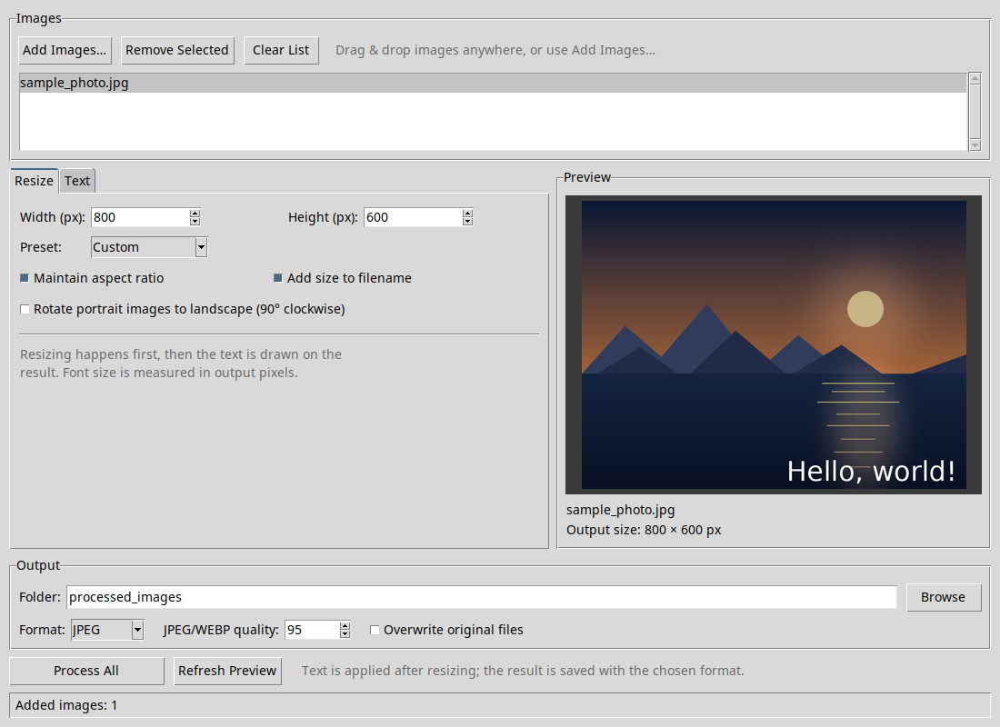

<p align="center">
  
</p>

# 🖼️ Image Manipulator

Combines two tools — **Image Resizer Pro** and **Image Text Overlay** — into a
single application. Batch-process images in one pass:

**load → resize → add text → save**

## ✨ Features

- 📦 **Batch processing** — every loaded image is processed with the same settings
- 🖱️ **Drag & drop** — drop files onto the window (requires `tkinterdnd2`)
- 📏 **Resizing** — width/height, presets, and aspect-ratio preservation
- 🔄 **Portrait rotation** — optionally turn portrait images into landscape before resizing
- 🎨 **Custom icon** — the window, About dialog, and executables share one icon
- 🔤 **Text** — content, color, position, offsets, font family, style, and size
- 🎨 **Fonts** — system font families or a custom `.ttf`/`.otf` file
- 👁️ **Live preview** — the result and output size update as settings change
- 💾 **Output formats** — JPEG, PNG, WEBP, BMP; transparency is flattened onto white for JPEG/BMP
- 🧭 **Orientation** — EXIF rotation is baked into the pixels before resizing
- 💽 **Settings persistence** — all settings are restored on the next launch
- 📊 **Progress and errors** — processing runs in a background thread with a batch summary
- 🌍 **Interface languages** — 11 languages, selectable in File → Language
- 🔄 **Update check** — optional check for a newer release at every launch, with a direct download for your OS

## 🖼️ Screenshot

<p align="center">
  
</p>

## 🔑 Key Behavior

**Order matters:** an image is resized first, and the text is then drawn on the
resulting size. Font size is therefore measured in pixels of the **output**
image, not the source image.

**Portrait images:** with “Rotate portrait images to landscape” enabled,
images taller than they are wide are rotated 90° clockwise **before**
resizing. EXIF orientation has already been baked in by that point, so the
real display orientation is used. Square and landscape images are left
unchanged.

**Filenames:** `<name>_<width>x<height>_text.<ext>` — the parts are configurable:

| Setting | Filename part |
|---------|---------------|
| “Add size to filename” | `_<width>x<height>` |
| Non-empty text | `_text` |

For example: `photo_800x600_text.jpg`. If a file with that name already exists
in the output folder, a numeric suffix is added: `photo_800x600_text_1.jpg`.

**Overwriting:** with “Overwrite original files” enabled, the result replaces
the original file and keeps its original format. Otherwise, results are written
to the output folder in the selected format.

**Output folder:** by default results go to `processed_images` on the Desktop
(`~/Desktop/processed_images` on Linux and macOS,
`%USERPROFILE%\Desktop\processed_images` on Windows). If there is no Desktop
folder, the home directory is used.

## 🌍 Interface Languages

The interface is available in English, Russian, Spanish, French, German,
Portuguese (Brazil), Italian, Chinese (Simplified), Japanese, Korean, and
Tagalog (Filipino).
Choose a language under **File → Language**; it applies after the application
is restarted. On the first launch the language is taken from the OS locale and
falls back to English.

Output filenames and the default output folder stay language-neutral
(`_text`, `processed_images`). Translations other than English and Russian are
best-effort drafts and may need native review.

## 🔄 Update Check

When enabled (the default), the application asks the GitHub Releases API at
every startup whether a newer version exists. Only public release metadata is
read — no personal data or usage information is sent. If a newer version is
found, a dialog shows the direct download link for the running OS (Linux,
Windows, or macOS); the button opens it in the default browser. When the
platform asset is missing, the release page is used instead.

Turn the automatic check off under **Help → Check for Updates Automatically**.
**Help → Check for Updates…** runs a check on demand. Automatic failures are
silent; manual failures are reported.

## 📦 Download

Installers are published with every release:

| Platform | Installer | Install |
|----------|-----------|---------|
| Debian / Ubuntu | `ImageManipulator-<version>-linux-amd64.deb` | `sudo apt install ./<file>.deb` |
| Fedora / RHEL / openSUSE | `ImageManipulator-<version>-linux-<arch>.rpm` | `sudo dnf install ./<file>.rpm` or `sudo zypper install ./<file>.rpm` |
| Windows 10/11 | `ImageManipulator-<version>-windows-setup.exe` | Run the wizard |
| macOS | `ImageManipulator-<version>-macos.dmg` | Open and drag to Applications |

| Platform | Uninstall |
|----------|-----------|
| Debian / Ubuntu | `sudo apt remove image-manipulator` |
| Fedora / RHEL / openSUSE | `sudo dnf remove image-manipulator` or `sudo zypper remove image-manipulator` |
| Windows | Settings → Apps → Image Manipulator → Uninstall |
| macOS | Move Image Manipulator from Applications to the Trash |

The installers are unsigned. Windows SmartScreen and macOS Gatekeeper may warn;
on macOS, right-click the app and choose **Open** the first time. The
application itself runs without administrator rights after installation.

## 📥 Installation

```bash
git clone <repo-url> image-manipulator
cd image-manipulator
python -m venv .venv
source .venv/bin/activate  # Linux/macOS
# .venv\Scripts\activate   # Windows
pip install -e ".[dev,dnd,multimonitor]"
```

Minimum dependency: `Pillow>=10`.
Optional: `tkinterdnd2` (drag & drop) and `screeninfo` (centering the window on
the monitor under the pointer).

## 🚀 Running

```bash
python main.py
```

Or, after installation:

```bash
python -m image_manipulator
image-manipulator
```

### How to Use

1. Click **Add Images…** or drag files onto the window.
2. On the **Resize** tab, set the dimensions, preset, and aspect ratio.
3. On the **Text** tab, set the text, color, position, and font.
4. In the **Output** section, choose the folder, format, and overwrite behavior.
5. Click **Process All** to process and save every image.

Settings are saved automatically. `File → Reset Settings` restores the defaults
and deletes the settings file.

## 📁 Supported Formats

- **Input:** PNG, JPEG, BMP, GIF, TIFF, WEBP
- **Output:** JPEG, PNG, WEBP, BMP (when overwriting, the original format is kept, including GIF/TIFF)

## 🏗️ Project Structure

```
src/image_manipulator/
├── app.py             # application bootstrap and root window
├── config.py          # constants and default values
├── resize.py          # dimension calculation and resampling (Pillow)
├── text_overlay.py    # font selection, styles, and text drawing
├── pipeline.py        # load → resize → text → save
├── settings_store.py  # versioned JSON settings
├── positioning.py     # centering the window and dialogs
├── dialogs.py         # About and modal messages
└── ui.py              # Tkinter main window
```

Processing logic is independent of Tkinter: `resize.py`, `text_overlay.py`, and
`pipeline.py` do not import the GUI and are covered by tests.

## 🧪 Tests

```bash
make test
# or
python -m pytest -v
```

## 🔨 Building

Portable executable for the current platform:

```bash
make pyinstaller
```

The icon is selected automatically by platform: `assets/icon.ico` on Windows,
`assets/icon.icns` on macOS, and `assets/icon.png` on Linux. The result is
`dist/ImageManipulator`.

Installers are built by CI (`.github/workflows/build.yml`):

| Platform | Packaging |
|----------|-----------|
| Linux | `packaging/linux/build_packages.sh` builds `.deb` and `.rpm` |
| Windows | `packaging/windows/image-manipulator.iss` (Inno Setup) builds `setup.exe` |
| macOS | `hdiutil` wraps `Image Manipulator.app` into a `.dmg` |

Regenerate every icon variant (PNG 1024, ICO with sizes 16–256, ICNS, and a
256 px PNG for the window):

```bash
python tools/generate_icon.py
```

## ⚙️ Settings File

The path depends on the platform:

| OS | Path |
|----|------|
| Linux | `$XDG_CONFIG_HOME/image-manipulator/settings.json` (defaults to `~/.config/...`) |
| macOS | `~/Library/Application Support/image-manipulator/settings.json` |
| Windows | `%APPDATA%\image-manipulator\settings.json` |

A corrupt file is ignored; an invalid individual field falls back to its
default while the remaining settings load as-is.

## ℹ️ About

- **Version:** 1.6.1
- **License:** MIT
- **Author:** Pavlenko Evgeniy
- **Email:** [pavlenkoevgeniy85@gmail.com](mailto:pavlenkoevgeniy85@gmail.com)

Copyright © 2026
