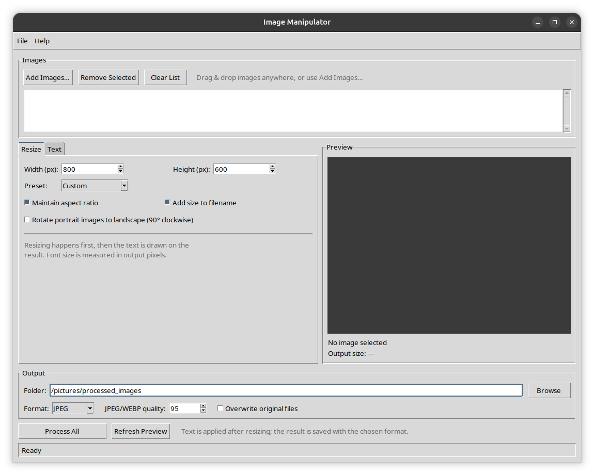

<p align="center">
  
</p>

# 🖼️ Image Manipulator

Объединяет два инструмента — **Image Resizer Pro** и **Image Text Overlay** — в одно
приложение. Пакетная обработка изображений в один проход:

**загрузить → изменить размер → нанести текст → сохранить**

## ✨ Возможности

- 📦 **Пакетная обработка** — все загруженные изображения обрабатываются с одними настройками
- 🖱️ **Drag & drop** — перетаскивание файлов в окно (при установленном `tkinterdnd2`)
- 📏 **Ресайз** — ширина/высота, пресеты, сохранение пропорций
- 🔄 **Поворот портретных фото** — опция превращает вертикальные изображения в горизонтальные до ресайза
- 🎨 **Фирменная иконка** — окно, About и исполняемые файлы используют единую иконку
- 🔤 **Текст** — содержимое, цвет, позиция, отступы, семейство шрифта, стиль и размер
- 🎨 **Шрифты** — системные семейства или пользовательский `.ttf`/`.otf`
- 👁️ **Живой предпросмотр** — итоговый размер и результат обновляются при изменении настроек
- 💾 **Форматы вывода** — JPEG, PNG, WEBP, BMP; прозрачность корректно сводится на белый для JPEG/BMP
- 🧭 **Ориентация** — EXIF-поворот «запекается» в пиксели до ресайза
- 💽 **Сохранение настроек** — все параметры восстанавливаются при следующем запуске
- 📊 **Прогресс и ошибки** — обработка в фоновом потоке, итоговая сводка по батчу

## 🖼️ Скриншот

<p align="center">
  
</p>

## 🔑 Ключевое поведение

**Порядок важен:** изображение сначала ресайзится, и только потом на итоговый размер
наносится текст. Поэтому размер шрифта задаётся в пикселях **выходного** изображения,
а не исходного.

**Портретные фото:** при включённой опции «Rotate portrait images to landscape»
изображения, у которых высота больше ширины, поворачиваются на 90° по часовой
стрелке **до** ресайза. EXIF-ориентация к этому моменту уже запечена, поэтому
проверяется реальная ориентация отображения. Квадратные и горизонтальные фото
не меняются.

**Имена файлов:** `<имя>_<ширина>x<высота>_text.<ext>` — части настраиваются:

| Настройка | Часть имени |
|-----------|-------------|
| «Add size to filename» | `_<ширина>x<высота>` |
| Непустой текст | `_text` |

Например: `photo_800x600_text.jpg`. Если файл с таким именем уже есть в папке
вывода, добавляется числовой суффикс: `photo_800x600_text_1.jpg`.

**Перезапись:** при включённой опции «Overwrite original files» файл сохраняется на
месте оригинала в его исходном формате. Иначе результаты пишутся в папку вывода в
выбранном формате.

## 📥 Установка

```bash
git clone <repo-url> image-manipulator
cd image-manipulator
python -m venv .venv
source .venv/bin/activate  # Linux/macOS
# .venv\Scripts\activate   # Windows
pip install -e ".[dev,dnd,multimonitor]"
```

Минимальные зависимости: `Pillow>=10`.
Опциональные: `tkinterdnd2` (drag & drop), `screeninfo` (центрирование на мониторе
с курсором).

## 🚀 Запуск

```bash
python main.py
```

или после установки:

```bash
python -m image_manipulator
image-manipulator
```

### Как работать

1. **Add Images…** или перетащите файлы в окно.
2. На вкладке **Resize** задайте размер, пресет и пропорции.
3. На вкладке **Text** задайте текст, цвет, позицию, шрифт.
4. В блоке **Output** выберите папку, формат и (при необходимости) перезапись.
5. **Process All** — обработать и сохранить все изображения.

Настройки сохраняются автоматически. `File → Reset Settings` возвращает значения
по умолчанию и удаляет файл настроек.

## 📁 Поддерживаемые форматы

- **Вход:** PNG, JPEG, BMP, GIF, TIFF, WEBP
- **Выход:** JPEG, PNG, WEBP, BMP (при перезаписи — исходный формат, включая GIF/TIFF)

## 🏗️ Структура проекта

```
src/image_manipulator/
├── app.py             # запуск приложения, создание окна
├── config.py          # константы и значения по умолчанию
├── resize.py          # расчёт размеров и ресемплинг (Pillow)
├── text_overlay.py    # подбор шрифта, стили, отрисовка текста
├── pipeline.py        # load → resize → text → save
├── settings_store.py  # версионируемый JSON настроек
├── positioning.py     # центрирование окна и диалогов
├── dialogs.py         # About и модальные сообщения
└── ui.py              # главное окно Tkinter
```

Логика обработки отделена от Tkinter: `resize.py`, `text_overlay.py` и `pipeline.py`
не зависят от GUI и покрыты тестами.

## 🧪 Тесты

```bash
make test
# или
python -m pytest -v
```

## 🔨 Сборка исполняемого файла

```bash
make pyinstaller
```

Иконка выбирается автоматически по платформе: `assets/icon.ico` для Windows,
`assets/icon.icns` для macOS, `assets/icon.png` для Linux. Результат — `dist/ImageManipulator`.

Пересобрать все варианты иконки (PNG 1024, ICO с размерами 16–256, ICNS и
PNG 256 для окна):

```bash
python tools/generate_icon.py
```

## ⚙️ Файл настроек

Путь зависит от платформы:

| ОС | Путь |
|----|------|
| Linux | `$XDG_CONFIG_HOME/image-manipulator/settings.json` (по умолчанию `~/.config/...`) |
| macOS | `~/Library/Application Support/image-manipulator/settings.json` |
| Windows | `%APPDATA%\image-manipulator\settings.json` |

Повреждённый файл игнорируется; невалидное отдельное поле заменяется значением
по умолчанию.

## ℹ️ О программе

- **Версия:** 1.2.0
- **Лицензия:** MIT
- **Автор:** Pavlenko Evgeniy
- **Email:** pavlenkoevgeniy85@gmail.com

Copyright © 2026
